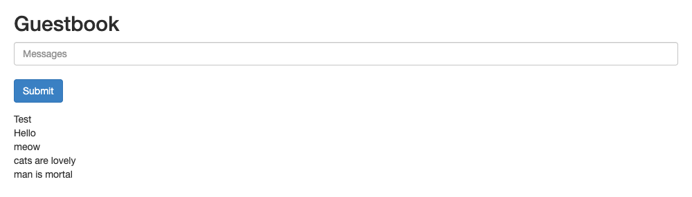
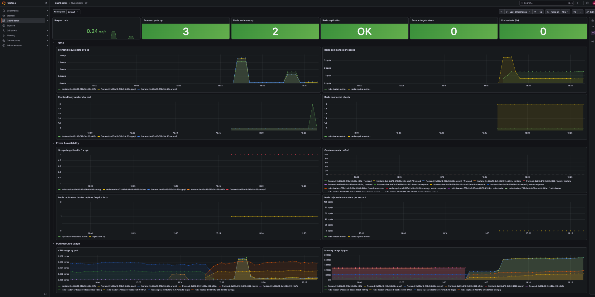

# Kubernetes Guestbook with Prometheus & Grafana

An extension of Pulumi's [Kubernetes Guestbook (components) example](https://github.com/pulumi/examples/tree/master/kubernetes-ts-guestbook/components)
that adds monitoring. One `pulumi up` deploys:

- **The Guestbook**: PHP frontend (3 replicas), Redis leader and Redis replica.
- **Prometheus and Grafana**, via the [`kube-prometheus-stack`](https://github.com/prometheus-community/helm-charts/tree/main/charts/kube-prometheus-stack) Helm chart.
- **Metrics exporters** as sidecars on every Guestbook pod, plus a `ServiceMonitor` per service so Prometheus scrapes them.
- **A Grafana dashboard** for the Guestbook, provisioned from code.

## Prerequisites

- [Pulumi CLI](https://www.pulumi.com/docs/install/) (tested on v3.272.0)
- [Node.js](https://nodejs.org/) 20+ (tested on v22.20.0)
- `kubectl` (tested on v1.34.1)
- A Kubernetes cluster (tested on Docker Desktop's built-in Kubernetes, v1.34.1)

## Deploy

```bash
npm install

pulumi login --local
export PULUMI_CONFIG_PASSPHRASE=""

pulumi stack init dev
pulumi config set isMinikube false

pulumi up
```

The committed `Pulumi.dev.yaml` uses an empty passphrase. To use your own passphrase or Pulumi Cloud,
pick a different stack name, e.g. `pulumi stack init mine`.

When the deploy finishes, Pulumi prints:

```
Outputs:
    frontendUrl         : "http://localhost"
    grafanaAdminPassword: [secret]
    grafanaAdminUser    : "admin"
    grafanaUrl          : "http://localhost:3000"
```

Open `frontendUrl` to use the Guestbook:



## Access Grafana

| | |
|---|---|
| **URL** | `pulumi stack output grafanaUrl`. On Docker Desktop this is **http://localhost:3000** |
| **Username** | `admin` |
| **Password** | `pulumi stack output grafanaAdminPassword --show-secrets` |

The password is generated by Pulumi for each stack, rather than using the chart's default.

The **Guestbook** dashboard is at `<grafanaUrl>/d/guestbook`. It shows request rate, Redis activity,
availability (target health, restarts, replication status) and CPU/memory per pod:



## Verify that Prometheus is scraping the Guestbook

Prometheus isn't exposed outside the cluster, so open a tunnel to it:

```bash
kubectl port-forward -n monitoring svc/monitoring-kube-prometheus-prometheus 9090:9090
```

1. Open http://localhost:9090/targets. These targets should all be **UP**:
   - `serviceMonitor/default/frontend/0`: 3 endpoints, one per frontend pod
   - `serviceMonitor/default/redis-leader/0`: 1 endpoint
   - `serviceMonitor/default/redis-replica/0`: 1 endpoint

2. Run these queries at http://localhost:9090/query:

   | Query | Expected |
   |---|---|
   | `up{namespace="default", container="metrics-exporter"}` | 5 series, all `1` |
   | `sum by (pod) (rate(apache_accesses_total[1m]))` | Requests/s per frontend pod |
   | `rate(redis_commands_processed_total[1m])` | Commands/s for the leader and replica |

3. From the command line, `kubectl get servicemonitors` should list `frontend`, `redis-leader` and
   `redis-replica`, and `kubectl get pods` should show `2/2` containers per Guestbook pod: the app plus its exporter.

## Clean up

```bash
pulumi destroy
pulumi stack rm dev
```
